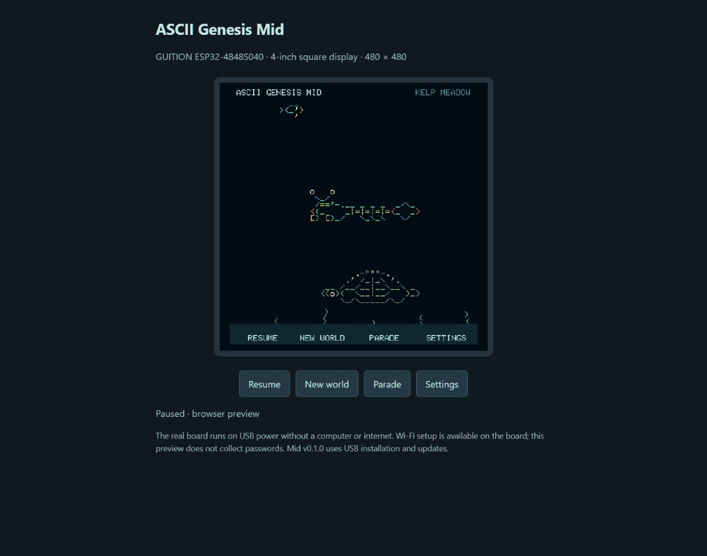

# ASCII Genesis — Mid

A traveling ASCII ocean for **GUITION ESP32-4848S040**, displayed on a **4-inch, 480 × 480 square touchscreen**.

## With thanks to the projects that started it

ASCII Genesis grew from **[Asciiquarium](https://github.com/cmatsuoka/asciiquarium)**, created by **Kirk Baucom**, with most original ASCII art credited to **Joan Stark** and expanded marine biodiversity by **Claudio Matsuoka**. Their shared work gave this ocean its foundation and much of its character.

**[OpenGhost](https://github.com/xanderchinxyz/OpenGhost)** by **xanderchinxyz and its contributors** inspired the early exploration of a small physical display. Thank you to both projects and the people who made them possible. Read the [full credits and project origins](CREDITS.md).

We call ASCII Genesis an **ocean**: its creatures travel through a scrolling world of changing terrain and habitats.

**This repository is the Mid project.** The other editions have separate projects: **[ASCII Genesis — Raspberry Pi](https://github.com/Mikepyt87/ascii-genesis)** and **[ASCII Genesis — Mini](https://github.com/Mikepyt87/ascii-genesis-mini)**. The three projects have different hardware, installers, and update channels.

## Start here

| Your situation | What to do |
| --- | --- |
| Building the Mid ocean for the first time | Follow [Mid installation and first startup](INSTALL.md) from the hardware check onward |
| Checking the board and wiring | Follow [board identification and pin assignments](HARDWARE.md); use the GUITION model listed below |
| Already installed and want new creatures | Connect Wi-Fi, open **Settings → Check for Updates → Install**, and keep power connected; see [wireless updates](INSTALL.md#wi-fi-setup) |
| Want to see the artwork and behavior | Open the [browser preview](DEVELOPMENT.md) or browse the [shared creature artwork library](https://github.com/Mikepyt87/ascii-genesis-mini/blob/main/docs/OCEAN-LIBRARY.md); Mid's timing and layout are described below |
| Have the little ESP32-S3 1.47-inch screen or a Raspberry Pi | Use the [Mini installation guide](https://github.com/Mikepyt87/ascii-genesis-mini/blob/main/docs/INSTALL.md) or [Pi installation guide](https://github.com/Mikepyt87/ascii-genesis/blob/main/raspberry-pi/SETUP.md) for that edition |

## Mid hardware

- GUITION **ESP32-4848S040**, with an ESP32-S3 N16R8 module, 16 MB flash, and 8 MB PSRAM.
- Integrated 4-inch ST7701 RGB display and GT911 capacitive touch, at **480 wide × 480 high**.
- A USB **data** cable and a computer for the first installation.
- A USB power source for normal use.
- Optional: home Wi-Fi or a phone hotspot operating at **2.4 GHz** for updates.

The display and touch controller connect directly to the ESP32 on the board. This is standalone ESP32 firmware; no Raspberry Pi, microSD card, operating-system installation, or API key is needed. Check the exact board marking and [hardware guide](HARDWARE.md) before installing; Mini uses a different display and touch controller.

## First software installation on the Mid

Use the [complete guide](INSTALL.md) to check the board, identify its USB port, and save the factory software first. Install [Python for Windows](https://www.python.org/downloads/windows/) if needed. Download **ascii-genesis-mid-usb.bin** from the newest [numbered Mid release](https://github.com/Mikepyt87/ascii-genesis-mid/releases). Then open **Windows PowerShell in the folder containing that file**, replacing **COM7** with your board's port:

```powershell
py -m venv .flash-tools
.\.flash-tools\Scripts\python.exe -m pip install esptool
.\.flash-tools\Scripts\python.exe -m esptool --chip esp32s3 --port COM7 --baud 460800 write-flash --flash-mode dio --flash-size 16MB --flash-freq 80m 0x0 ascii-genesis-mid-usb.bin
```

The ocean starts when the board restarts. Leave power connected for at least **30 seconds after startup**. If Mid v0.1.3 or newer is already installed, use the update instructions instead of flashing over it. [The full guide](INSTALL.md) explains the complete USB image, factory backup, port selection, first startup, Wi-Fi setup, and USB recovery. See [validation](VALIDATION.md) for the checks performed on the owner's board.

## What the Mid ocean includes

There are **28 colored creature and vehicle designs**, including the peacock mantis shrimp, six changing habitats, rising bubbles, swaying plants, and a scrolling seabed. Up to three creatures swim in separate bands. Startup and New World randomize the opening creatures, directions, positions, and habitat. It runs offline; Wi-Fi is optional for updates.

Tap the water for **Pause · New World · Parade · Settings**. The parade keeps all 28 designs in their original order, with six-second crossings and up to two creatures at a time. A full Mid parade takes **87 seconds (1 minute 27 seconds)**, then returns to the preserved ocean. The full names appear at the top right, with larger, brighter text from v0.1.5. Regular swimmers move at **9–18 logical pixels per second**, while the seabed scrolls at **3.6 logical pixels per second**. Mid draws a 320 × 320 scene and enlarges it evenly to the 480 × 480 screen, preserving the creatures' proportions.

Surface stretches bring sailing boats, whales that surface and spout, and an occasional Nessie-like sea monster. Castles and ruins pass along the seabed. Bubbles rise from creatures or the seabed, with no more than two on screen at once. Surface visitors take turns, and the creature parade keeps its own clear view.



The image is a browser preview, not a photograph of the board.

## Updates and source

The Mid updater follows this repository's wireless update channel. Connect home Wi-Fi or a 2.4 GHz hotspot, then use **Settings → Check for Updates → Install**. Keep power connected through the restart and for at least 30 seconds afterward. It checks for releases automatically but waits for you to choose Install. [The installation and update guide](INSTALL.md) covers Wi-Fi setup and recovery.

Current firmware: **v0.1.5**. Use a numbered [release](https://github.com/Mikepyt87/ascii-genesis-mid/releases) for installable firmware; [CHANGELOG.md](CHANGELOG.md) records the changes. Boards on v0.1.2 or earlier need one USB installation of v0.1.3 or newer before wireless updates are available. Mid accepts its own firmware and uses a separate channel from Mini.

The firmware and board drivers are in `firmware/`; the browser preview is in `preview/`; artwork is in `art/`; generators and checks are in `tools/`. Tests run in GitHub Actions. Use [Development](DEVELOPMENT.md) for the preview and ESP-IDF 6.1 build, [Hardware](HARDWARE.md) for the board references, and [Validation](VALIDATION.md) for completed checks and remaining hardware tests.

## Credits

Built on **Asciiquarium by Kirk Baucom**, with most upstream ASCII art credited to **Joan Stark** and expanded biodiversity by **Claudio Matsuoka**. **OpenGhost / xanderchinxyz** inspired the early display exploration. Project additions include the Mid renderer, original creatures, square layout, touch controls, Wi-Fi setup, and updater. Read [CREDITS.md](CREDITS.md), [THIRD-PARTY.md](THIRD-PARTY.md), and [LICENSE](LICENSE).

Firmware is GPL-3.0-or-later; artwork is [GPL-2.0-or-later](art/LICENSE.txt). The bitmap font retains its BSD notice.
